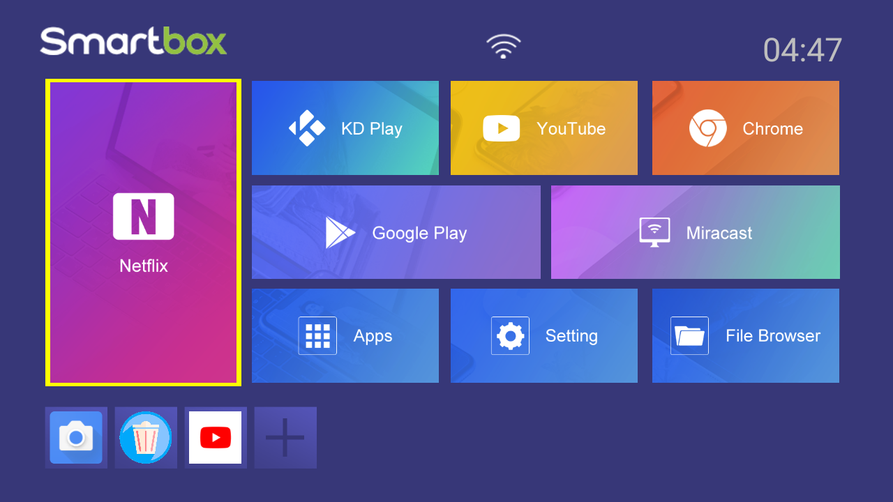
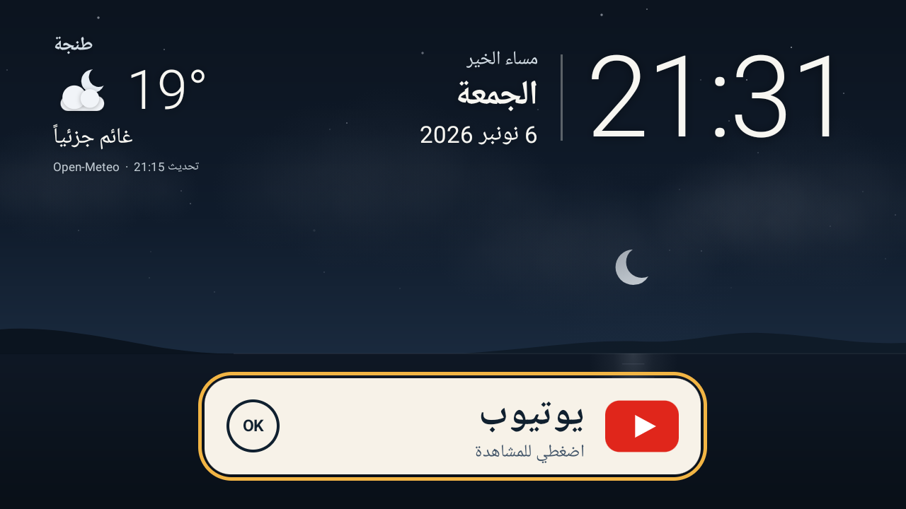

# Reclaiming my grandmother's TV box

**Recovery and reverse-engineering notes for an infected X96Q Android TV box, plus an experimental, version-pinned YouTube TV video-ad loader guard.**

| Before (2026-10-24, while infected) | After (2026-11-06) |
|---|---|
|  |  |

My grandmother's TV box is a cheap X96Q running Android 10. In October 2026 the household Internet became unusable. The box turned out to be the cause: it was uploading at about 27 Mbit/s, carrying payloads from the **Katana** botnet and an **Aisuru**-consistent executable, and it accepted shell commands from anyone on the LAN through unauthenticated network ADB.

I didn't want to throw it away. It is what she knows how to use, and she only needs one thing from it: YouTube, in a form she can manage on her own. This repository records how that box was investigated, cleaned up, reduced to a smaller set of apps and given a new one-button Arabic home screen. It also covers an experiment to stop YouTube's video ads from loading on that exact box.

The home screen itself is in the companion repository [Arabic TV Home](https://github.com/mehdii000/arabic-tv-home).

## Research approach

The useful result is the chain of evidence: traffic counters led to package attribution, exact payload hashes supported the Katana finding, and a separate runtime trace located the TV player's actual ad-loading path after mobile-app assumptions failed. Recovery changes were then checked across reboots rather than inferred from successful commands.

Start with [research method and evidence](docs/research-method.md) for the hypotheses, rejected approaches, reproducibility boundaries and remaining questions. The launcher and ad-loader experiment solve separate problems; suppressing ads is not malware remediation.

## What's here

| Path | What it is |
|---|---|
| [docs/research-method.md](docs/research-method.md) | Reasoning, evidence map, rejected approaches and follow-up experiments. |
| [docs/incident.md](docs/incident.md) | Findings: unauthenticated ADB, Katana payload matches, traffic attribution, Aisuru association, and remnants on the reserve partition. Public indicator hashes are included. |
| [docs/recovery.md](docs/recovery.md) | What was removed, disabled and kept, the clock repair, the switch to the patched YouTube, update controls and rollback. |
| [ad-guard/](ad-guard/) | Source, build recipe and tests for the experimental video-ad loader guard. **You supply the APK and link libraries**; exact-player tests additionally need your capture. No Google binary or full player script is included. |
| [recovery/](recovery/) | The helper that released the vendor MDM's device-owner role. |
| [docs/evidence/](docs/evidence/) | Small sanitised excerpts: native guard logs. |

## Results at a glance

- **Malware:** all ten embedded executables of the installed `com.system.update` match Nokia Deepfield's published Katana hashes. A second package's native executable contains Aisuru's documented key. A further unknown ARM ELF and its watchdog script were found later on `/Reserve0`, then preserved and removed. These remnants were **not** observed running.
- **Cleanup:** malware and suspicious loaders were removed, 48 preinstalled apps disabled, the vendor device owner released, a persistent remote-care service removed for user 0, and the clock fixed. Real reboots confirmed that each change held.
- **Package controls:** Play Store, two vendor app stores and two vendor OTA updaters are disabled, and the changes survived reboot. The original YouTube is disabled but kept for rollback.
- **Ad guard:** a 9,328-byte shim patches one 20-byte statement in one pinned player version and then restores all six native imports. On the same documentary, the original app showed a Ferrero Rocher pre-roll and the patched app showed no video ad in 32 sampled seconds. That is one comparison on one device, not a guarantee.
- **Reproducible:** the published sources rebuild the deployed shim byte-for-byte, and the launcher's DEX matches the deployed one.

## What this does *not* show

- **Firmware integrity.** This was a cleanup of the existing image: no reflash, no factory reset, no memory or storage forensics. The box is cleaner, not certified clean.
- **How it was infected.** Supply chain, sideloading and later exploitation all remain possible.
- **That the reserve-partition remnants were active.** They were found and removed. A running copy or a startup hook was never observed.
- **A general ad blocker.** The guard targets one module of one downloaded player version. Feed ads, sponsorships and server-stitched ads are untouched, and when YouTube changes its player the guard simply stops matching.
- **A speedup.** No startup or buffering improvement was measured.

## What is not published, and why

| Withheld | Reason |
|---|---|
| Raw ADB logs, package dumps, process and socket lists | contain device and network identifiers |
| LAN addresses, hardware addresses, remote endpoints | identify the household and network |
| Malware samples | not redistributed; hashes are given instead |
| Google's YouTube APK, Cobalt engine, Android system libraries and the captured player JavaScript | third-party inputs; the APK and engine are hash-pinned, and exact-player tests check the capture digest. Link libraries are supplied locally but are not hash-gated |
| Signing keys, YouTube guest-state backups, recommendation screenshots | private |
| ADB collectors and network scanning tools | environment-specific and not prepared or reviewed as reusable tooling |
| Ad screenshots from the comparison | third-party content; described in text instead |

## Method and ethics

All access was to a device my family owns, with the owner's authorisation at each step. The investigation phase was analysis-only. Cleanup, package controls and every later device change were separately approved. Collected malware samples were analysed statically and were not deliberately executed by the investigator; malware processes were already running on the box when discovered. The investigator did not contact suspected command-and-control endpoints. Temporary instrumentation (Frida) was loopback-only and removed afterwards, and the guard needs none of it at runtime.

## How it was made

This work was done with AI coding agents, with me setting the research questions, authorising device changes and choosing the scope. Agents performed the recorded analysis and ADB operations. This is an AI-assisted case study, not a claim that I manually authored every line or performed every tool operation.

- **Codex** (OpenAI): documented November device work, Arabic Home review and deployment, the boot-animation and debloat pass, and the ad-guard investigation, implementation and deployment. A separate Codex reviewer produced two findings before its review was interrupted; the fixes and review limits are recorded in [ad-guard/README.md](ad-guard/README.md#review-status). Earlier incident findings are attributed to their evidence rather than to an unverified individual author.
- **Claude** (Anthropic): Arabic Home 3.0 redesign; preparation of these public exports (sanitisation, configurable builds, tests that run without third-party inputs, documentation). Codex then reviewed the exports and clarified their evidence and failure-mode descriptions.
- Static analysis used Ghidra and REA. Public threat intelligence comes from Nokia Deepfield's Katana and Aisuru research.

## License

Not yet chosen.
