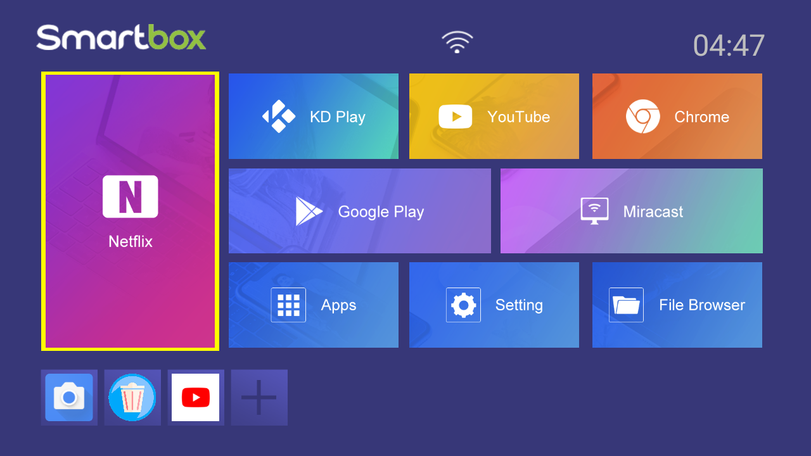
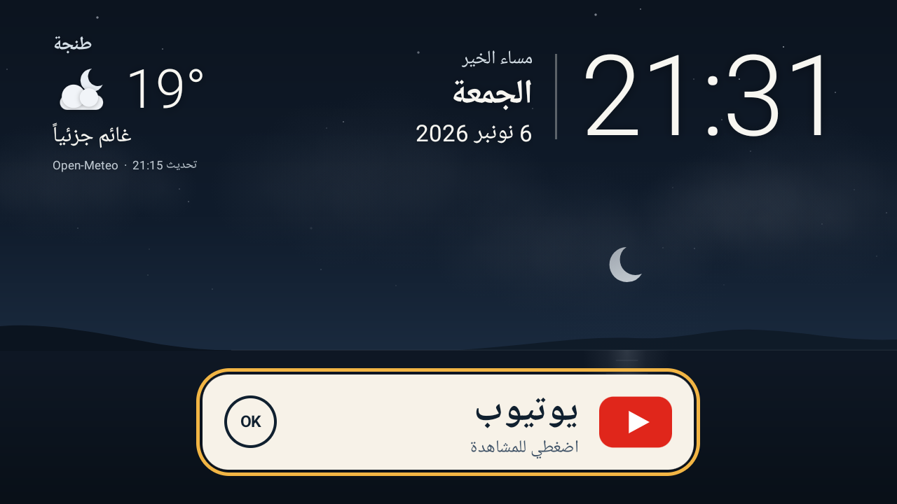

# Recovery and package controls

Everything here was done to one box, with the owner's explicit authorisation at each stage, over the existing ADB access. The goal was not a pristine device. The operational goal was reliable YouTube access for my grandmother and removal of the observed malicious components. This did not establish a trusted firmware image or comprehensively harden the network/debug interfaces.

## Stage 1 — cleanup and YouTube-only profile (2026-10-24)

- **Malware and backups removed.** Six identified bot and updater packages were removed, along with four hidden APK backup copies whose hashes matched the confirmed Katana wrapper.
- **Downloaded apps pruned.** 23 other downloaded apps were removed. They included remaining suspicious loaders with names such as `com.proxy.app`, `a.b.c`, `com.android.internal.telemetry` and `com.google.android.adffa`, as well as unwanted streaming and gaming apps. Not every removed app was analysed, and none is claimed to be malware on its name alone.
- **48 preinstalled apps disabled for user 0.** These were vendor stores, remote management, vendor updaters, the vendor launcher, browsers, optional apps, Google Play Services, Google Services Framework and the Play Store. Kept: Android platform support, Settings, keyboard, networking, media/DRM services and the WebView provider.
- **Vendor device owner released.** `com.easycontrol.mdm` was the active device-owner app. Releasing it once through `DevicePolicyManager` was not enough, because management came back. The second attempt disabled the package *before* clearing device ownership, and it held across restarts. The helper is in [../recovery/](../recovery/).
- A first one-button launcher was installed, and playback of a public test film was confirmed before and after a restart.

## Stage 2 — clock, launcher and debloat (2026-11-06)

- **Clock.** The box date was 2025-11-13, automatic time was off and the configured NTP host was invalid, so TLS failed and YouTube could not connect. Automatic time was enabled with `time.android.com`, and it synchronised after reboot.
- **Persistent remote-care service.** `com.android.remotecare.generic` was disabled but still running as a persistent system-UID process, using about 10 MB PSS. It declares `persistent=true`, remote-control services and boot receivers. It was removed for user 0 with `pm uninstall --user 0`; the firmware APK itself is untouched. It was confirmed absent after reboot. This is unrelated to physical remote input and CEC.
- **Reserve-partition remnants.** `/Reserve0/.monitor` and `/Reserve0/.update` were found, preserved and removed; see [incident.md](incident.md#5-follow-up-reserve-partition-remnants-2026-11-06).
- **Arabic Home installed.** The companion launcher repository replaced the first launcher.
- **Performance.** Before cleanup the box already had about 1.4 GB available memory and was mostly idle, so debloating is not claimed to have made it faster. The defensible direct saving is the removed persistent process, about 10 MB.
- **Boot animation.** A custom boot animation was installed as a `/data/local/bootanimation.zip` override. The original system file is untouched, and Ghidra confirmed that this firmware checks `/data/local` before `/system/media`. The artwork is not published here.

## Stage 3 — YouTube with the ad-loader guard, and update controls (2026-11-06)

At the owner's request, the experimental [ad-loader guard](../ad-guard/) became her default YouTube:

- Arabic Home 3.0.2 opens `com.google.android.youtube.tx`, a renamed copy of the same YouTube TV 2.07.02 APK with the guard shim, signed with a separate research key.
- The original `com.google.android.youtube.tv` is **disabled, not removed**, with its data intact for rollback. Its APK hash is unchanged.
- **Guest state migrated.** With both apps stopped, three signed-out guest-state files (the Cobalt local storage and two preference files) were copied to the new package, byte-verified and re-owned to its UID. Her populated recommendations appeared before and after a reboot. No account was involved. The files themselves are private and are not published.
- **Update sources disabled for user 0:** `com.android.vending` (Play Store), `com.yxt.appstore` and `com.androidkm.store` (vendor stores), `com.softwinner.update` and `com.abupdate.fota_demo_iot` (vendor OTA). These states survived a real reboot. The renamed, differently signed package also does not match Google's catalogue entry.
- **What this does not freeze.** These are Android package controls only. YouTube's TV interface and player code are downloaded at runtime, and its backend can change at any time. Such a change can make the guard stop matching (ads return) and will need a new, reviewed pin.

After the reboot: Home came back as the default, the clock was synchronised, the locale was unchanged, and the stores, updaters and original YouTube stayed disabled. One OK opened the patched app with her feed. The native log showed the patch applied and all six imports restored. A recommendation reached `PLAYING` at speed 1.0. Initial black and buffering frames were observed, so no faster startup is claimed.

## Rollback

- **YouTube:** `pm enable --user 0 com.google.android.youtube.tv`, then rebuild Arabic Home with `--youtube-package com.google.android.youtube.tv`, a `versionCode` above 6 and the original Home key, and install it. Do not uninstall or clear Home to downgrade. Remove `.tx` only after Home points back at `.tv`.
- **Boot animation:** delete `/data/local/bootanimation.zip` (root) and reboot.
- **Disabled packages:** `pm enable --user 0 <package>`. Packages removed with `pm uninstall --user 0` can be restored with `cmd package install-existing <package>`.

## What this is not

This is an operational cleanup and reduction of installed functionality on the existing firmware image. Disabled stores and OTA services also remove automatic update paths; the resulting setup needs owner maintenance and is not a general security baseline. It is **not** a certification of firmware integrity. There was no factory reset, no reflash and no bootloader work. The initial infection route is unknown. Replacing the firmware with a trusted image would be the stronger recovery, if one existed for this box.
